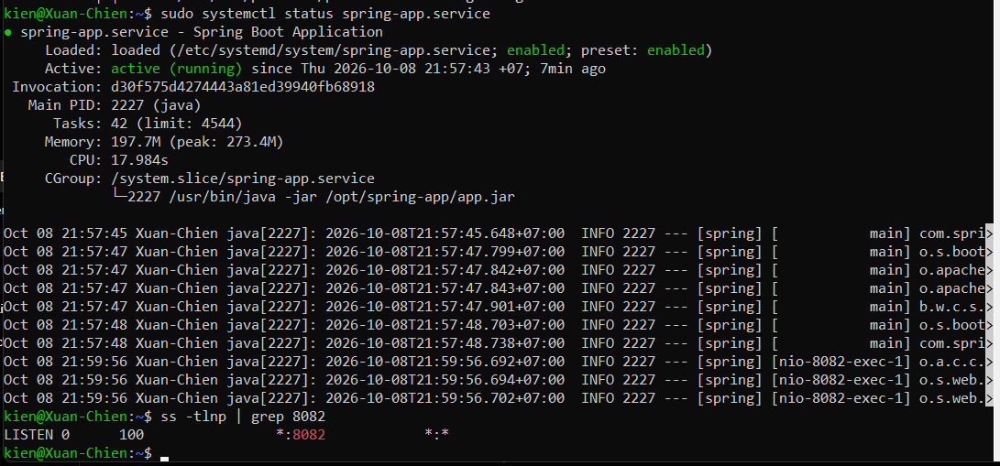

# Bài 3: Thiết lập Cơ sở dữ liệu và Systemd cho Spring Boot

## 1. Cơ sở dữ liệu

Đã tạo database MySQL:

```text
springboot_db

Tạo user:

spring-admin

Cấp toàn quyền trên database:

GRANT ALL PRIVILEGES ON springboot_db.* TO 'spring-admin'@'localhost';

Spring Boot được cấu hình kết nối tới database springboot_db.

2. Tài khoản chạy ứng dụng

Đã tạo user Linux:

spring-runner

User này không có shell login và được sử dụng để chạy ứng dụng Spring Boot.

Ứng dụng được đặt tại:

/opt/spring-app/app.jar
3. Cấu hình Systemd

File cấu hình:

/etc/systemd/system/spring-app.service

Nội dung:

[Unit]
Description=Spring Boot Application
After=network.target

[Service]
User=spring-runner
Group=spring-runner
WorkingDirectory=/opt/spring-app
ExecStart=/usr/bin/java -jar /opt/spring-app/app.jar
Restart=on-failure
RestartSec=10

[Install]
WantedBy=multi-user.target
4. Kiểm tra trạng thái dịch vụ

Lệnh:

sudo systemctl status spring-app.service

Kết quả:

Active: active (running)

Ứng dụng chạy bằng:

/usr/bin/java -jar /opt/spring-app/app.jar
5. Kiểm tra cổng 8082

Lệnh:

ss -tlnp | grep 8082

Kết quả:

LISTEN 0 100 *:8082 *:*

Ứng dụng đang lắng nghe trên cổng 8082.

6. Kiểm tra user chạy ứng dụng

Lệnh:

ps -o user,pid,cmd -p 2227

Kết quả cho thấy ứng dụng được chạy bởi:

spring-runner
```
ảnh minh chứng:
